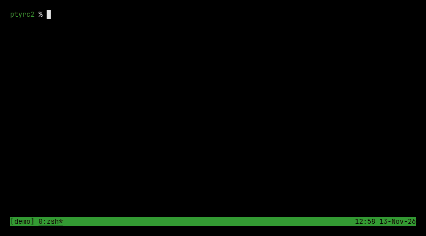
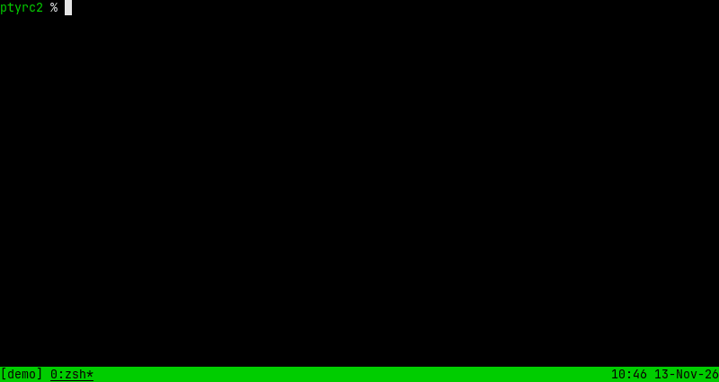
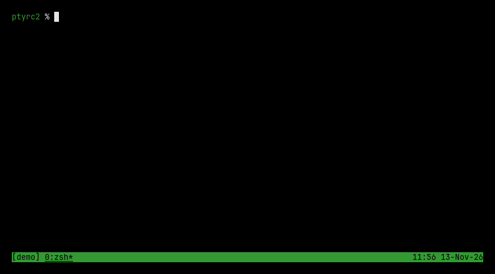
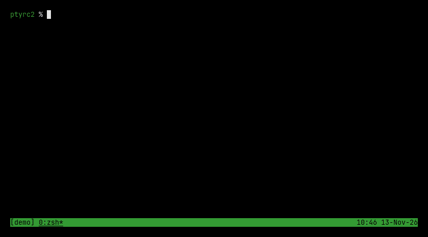
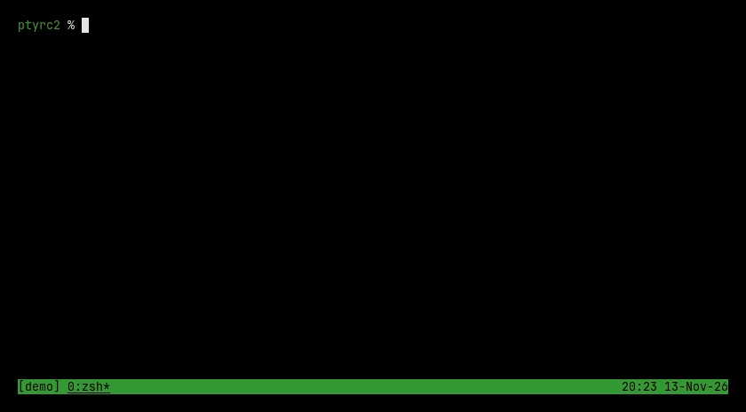

## `ptyrc2` gallery

See [`README.md`](./README.md) to learn more.

If you already started a driver, you can bind a user app as follows:

```sh
ptyrc app bricks
```

You can also directly start a user app with the driver:

```sh
ptyrc run --app 'flower -a' -- vim GALLERY.md
```

You then get flowers:



### confetti

Throw a party in your terminal:



### sand

You can sandbox any of your favorite applications with ease:


### fishes

If ever you feel like drowning, don't worry you'll be in good company:


### rain

You can get the perfect weather to appreciate the end of the world:


### snake

If you want to work on your ADHD as you are reviewing bad code:



### snow

You can cool down your terminal as our planet gets hotter every day:



### bricks

If you want to feel productive as you take notes on meetings:


### cat

Then finally, you remember what matters in life:


### stars

Sit down and watch as you find your calm back through all the noise:



## Contribute your own

These were made by a human banging its head on an agent, no code written.

Open a push request to add your own :)

## License

This project uses `GPL-3.0-or-later` where applicable.

See `LICENSE.txt`
