## `ptyrc2` gallery

See [`README.md`](./README.md) to learn more.

If you already started a driver, you can bind a user app as follows:

```sh
ptyrc app bricks
```

You can also directly start a user app with the driver:

```sh
ptyrc run --app 'flower -a' -- vim GALLERY.md
```

You then get flowers:

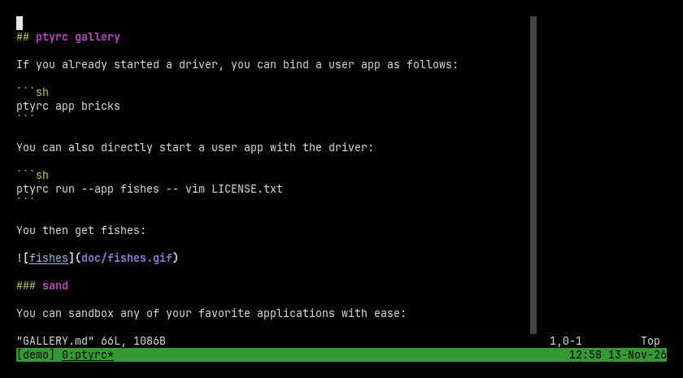

### confetti

Throw a party in your terminal:

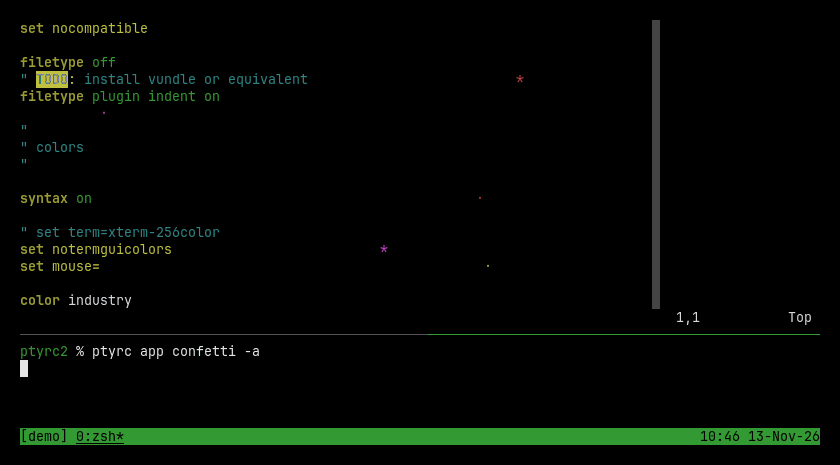

### flock

Perfect to catch a mood that will just not go away:

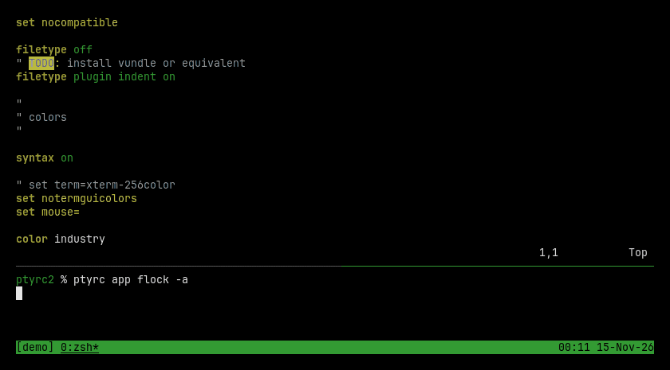

### sand

You can sandbox any of your favorite applications with ease:

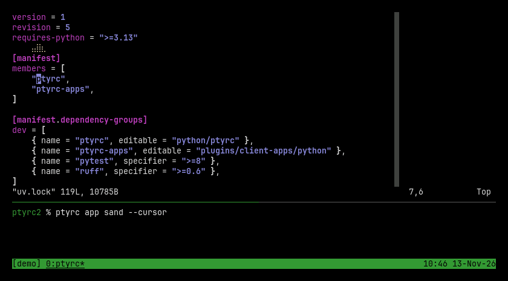

### fishes

If ever you feel like drowning, don't worry you'll be in good company:

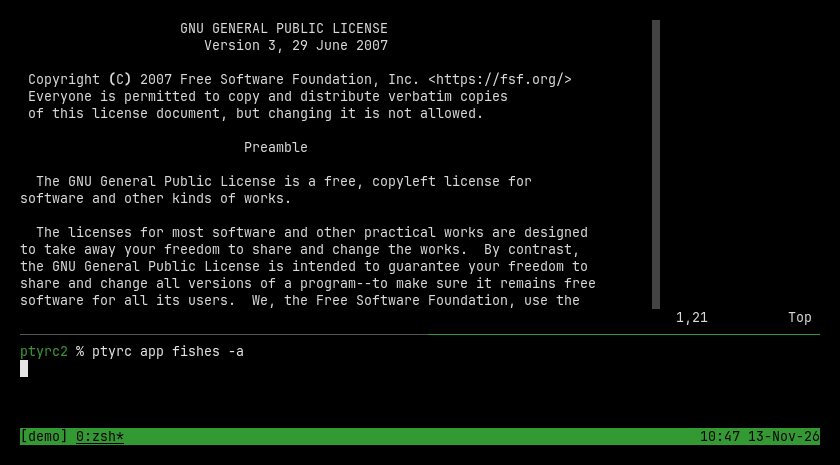

Also available as a "fish tank" widget if you are into these things:

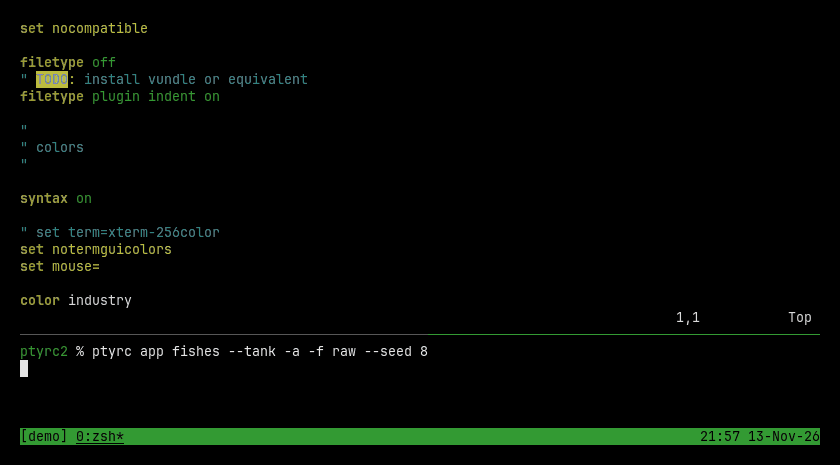

### rain

You can get the perfect weather to appreciate the end of the world:

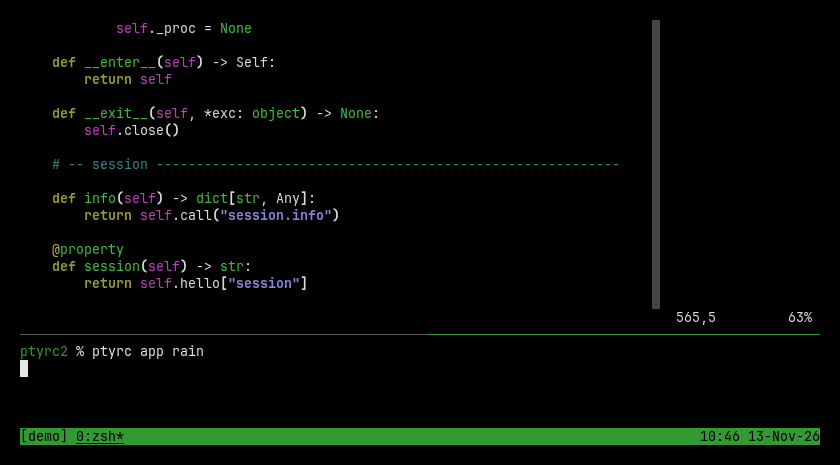

### cat

If you need to remember what matters in life:

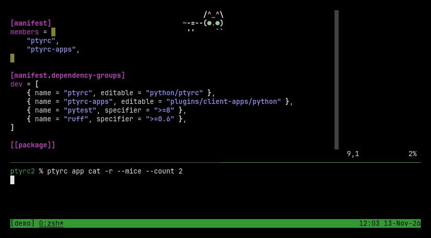

### snake

If you want to work on your ADHD as you are reviewing bad code:

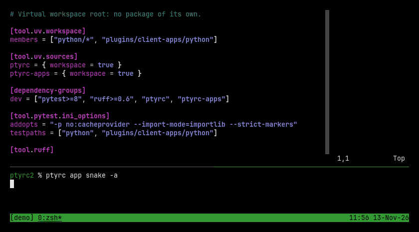

### stars

Sit down and watch as you find your calm back through all the noise:

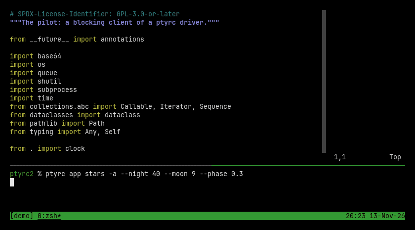

### snow

You can cool down your terminal as our planet gets hotter every day:

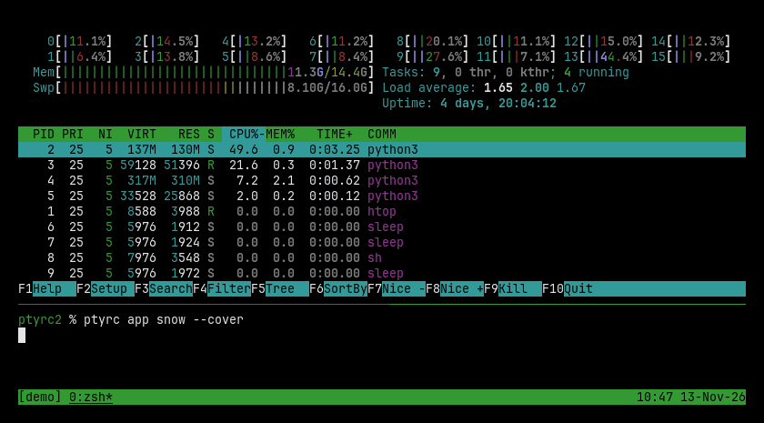

### window

You want to be outside but you are stuck in the open-space:


You can get some good company if you wave your cursor to the window:

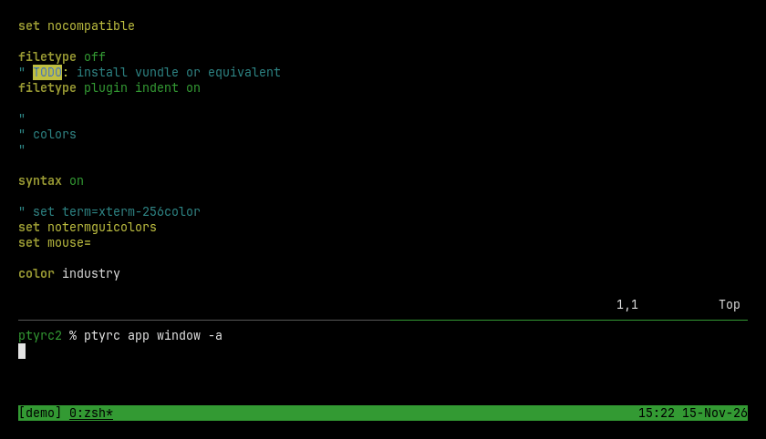

### bricks

If you want to feel productive as you take notes on meetings:

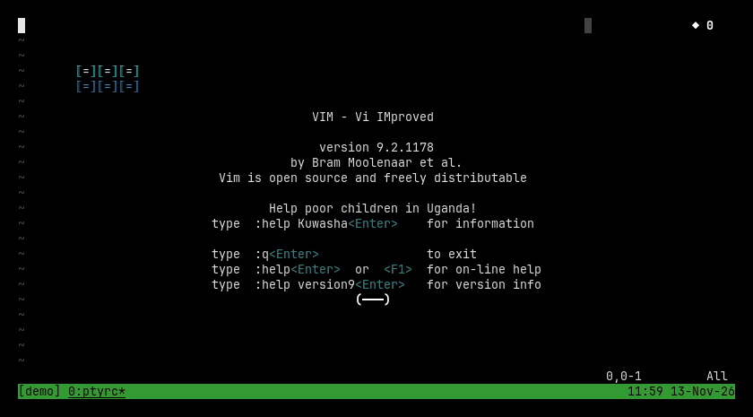

### pond

Another mindful way to continue write hand-crafted software with love:

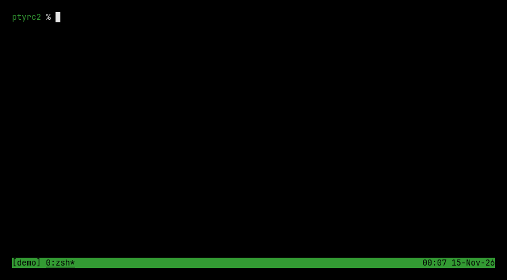

### train

The best part is the voyage after all, not the destination:

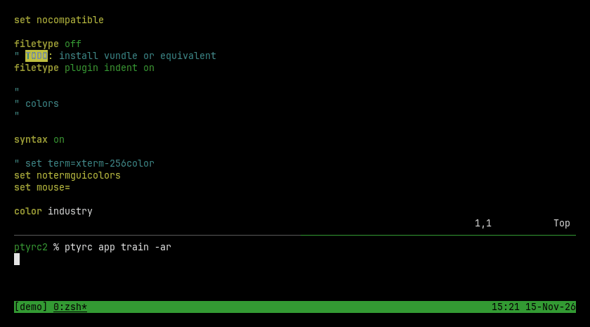

### gallery

You can decorate your terminal like some people decorate their toilets:


### shore

Feel all your problems running onto the shores of your indifference:

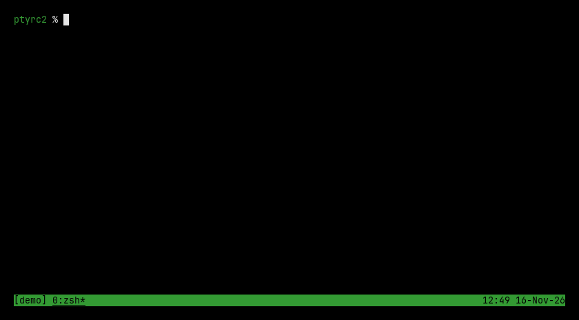

### globe

Perfect to celebrate the Christmas season alone in front of a computer:

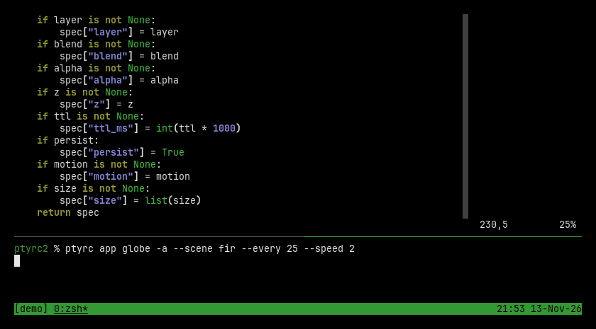

## Productivity Tools

Find experimental apps for productivity below.

Pin a post-it note to your terminal:

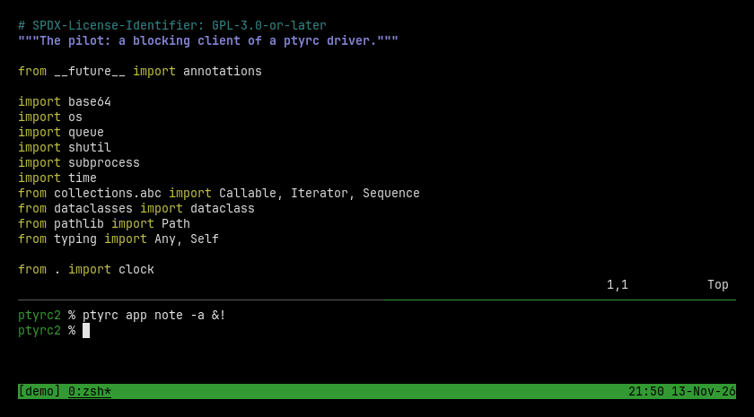

Display what is happening to locally to git:

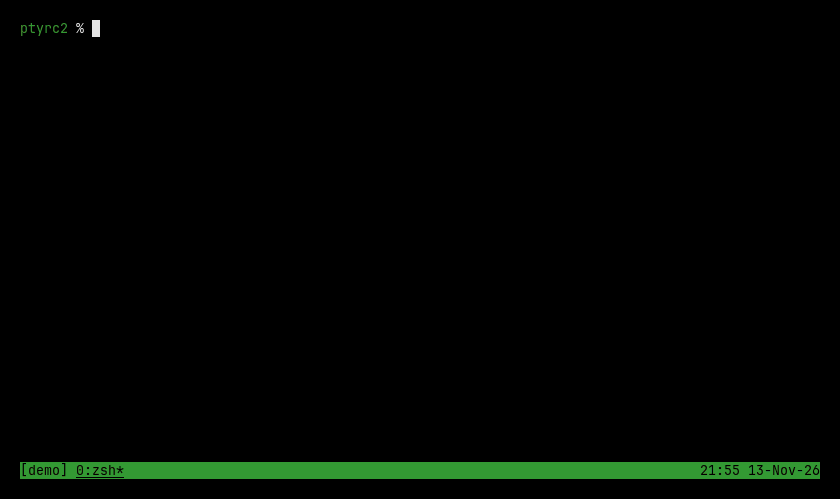

If you like working with a pomodoro timer:

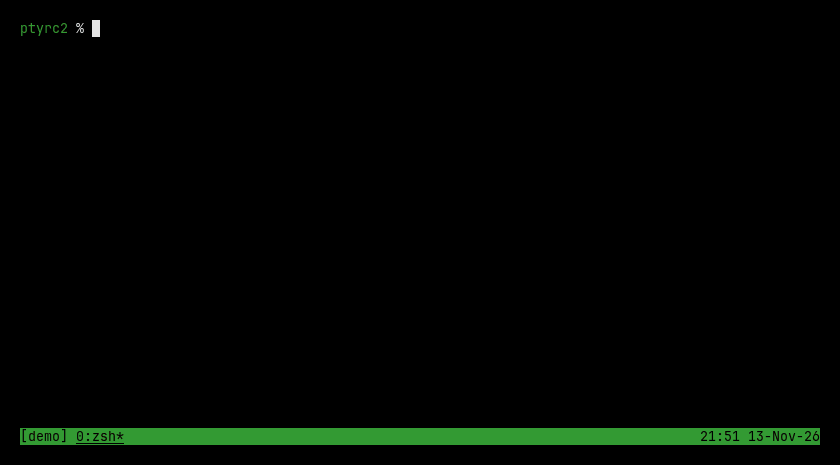

Not really productive, but if you like statistics:

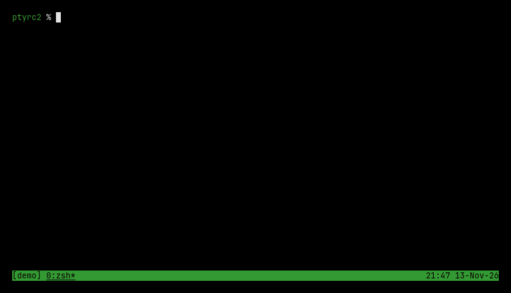

These apps have not been exercised by real users, expect bad friction.

## Contribute your own

These were made by a human banging its head on an agent, no code written.

Open a push request to add your own :)

## License

This project uses `GPL-3.0-or-later` where applicable.

See `LICENSE.txt`
