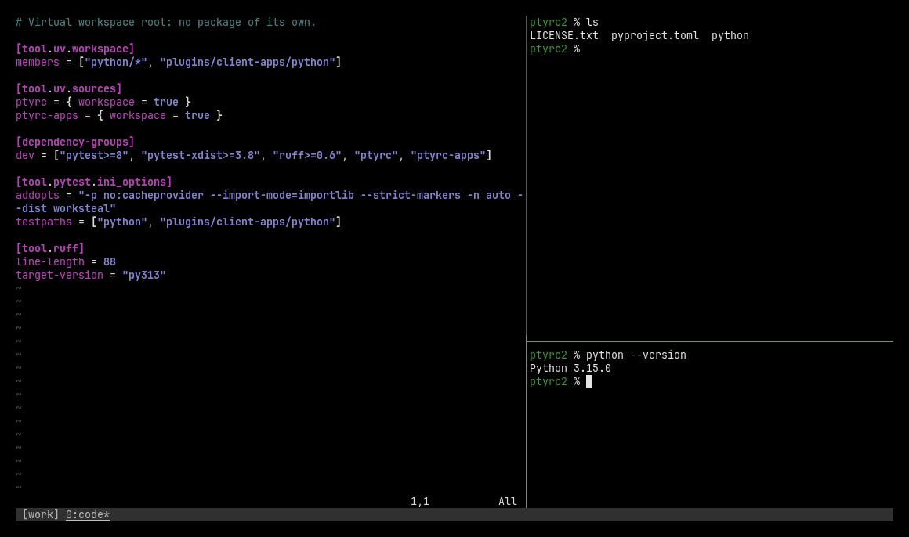

> This file was written by a human. The project uses generative coding.

# ptyrc2

This started as [`ptyrc`](https://github.com/pcplpc/ptyrc) a work done by hand
with the love of a human, now rebuild by the machine.


See the [`GALLERY.md`](GALLERY.md) if you want to see all the pictures.

## Usage

Wrap any application with `ptyrc` as follows:

```sh
ptyrc run vim ~/.vimrc
```

Then attach an application to it:

```sh
ptyrc app bricks
```

You can also wrap an existing `tmux` session using `ptyrc tmux attach`.

Use then `ctrl+t ctrl+t` to manage the running driver:



You can also use `ptyrc python` to [pilot](doc/interact.gif) your session.

Running `ptyrc python script.py` runs a client script with `pilot` exposed.

## Install from source

It's not published
on [crates.io](https://crates.io)
nor [PyPI](https://pypi.org), install from source.

Likely requires Linux, a Rust toolchain, `Python 3.13`
and optionally [just](https://just.systems).

```sh
git clone https://github.com/pcplpc/ptyrc2
cd ptyrc2
just install
```

This installs `ptyrc` into:

- `~/.cargo/bin` for the `ptyrc` native driver;
- `ptyrc-app` and `ptyrc-python` into `~/.local/bin` for pilot clients;
- both must be in your `PATH` to work.

Without using `just` you can:

```sh
cd ptyrc2
cargo install --locked --path rust/ptyrc-cli
uv tool install \
    --with ./python/ptyrc \
    --with-executables-from ptyrc \
    ./plugins/client-apps/python
```

Use `just uninstall` to remove them.

To try it without installing anything outside the clone:

```sh
just run vim        # cargo build --release && uv sync, then ptyrc run vim
```

No official release is available.

## Development

You can use:

```sh
just test           # cargo test --workspace && uv run pytest
just lint           # clippy, rustfmt, ruff
```

Honestly, the codebase is full of slop, it needs way more work.

You can still point your agent at it to write custom apps.

## License

This project uses `GPL-3.0-or-later` where applicable.

See `LICENSE.txt`
