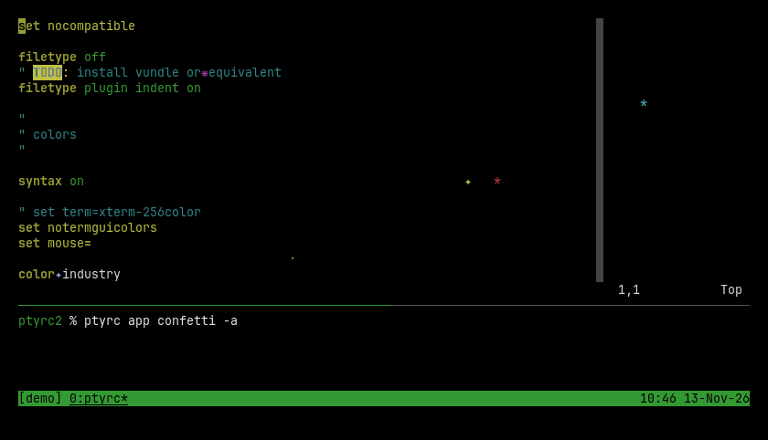

> This file was written by a human. The project uses generative coding.

# `ptyrc2` - the pty remote controller

Wrap your favorite tools in a terminal driver, which accepts clients that can
customize what you see:



This can drive anything that works in a terminal, like
[selenium](https://www.selenium.dev/) can drive anything a browser can do.

This started as [`ptyrc`](https://github.com/pcplpc/ptyrc), a wrapper around
[`pty`](https://docs.python.org/3/library/pty.html) made by hand with love.
Now rebuild with the machine.

See [`GALLERY.md`](GALLERY.md) for more examples.

## Usage

Wrap any application with `ptyrc` as follows:

```sh
ptyrc run vim ~/.vimrc
```

Then attach an application to it:

```sh
ptyrc app bricks
```

Wrap a `tmux` session with `ptyrc tmux attach`, then use `ctrl+t ctrl+t` to
manage the running driver from the inside:


You can also use `ptyrc python` to [pilot](doc/interact.gif) your terminal by
hand.

## Store apps

Apps can also come from a git repository, as scripts run in a sandbox
(WebAssembly, no file, no network), each asking for its permissions:

```sh
ptyrc store add ORIGIN  # install; see also: rm, update, ls, show, search
ptyrc app ID            # start it, a pop-up asks for what it declares
```

Write your own with `ptyrc dev new NAME`, then `ptyrc dev test` and
`ptyrc dev run`.

**The store is not yet safe for strangers' apps:** install only what you
have read or trust.

## Install from source

It's not published
on [crates.io](https://crates.io)
nor [PyPI](https://pypi.org), install from source.

Likely requires Linux, a Rust toolchain, `Python 3.13`
and optionally [just](https://just.systems).

```sh
git clone https://github.com/pcplpc/ptyrc2
cd ptyrc2
just install
```

This installs `ptyrc` into:

- `~/.cargo/bin` for the `ptyrc` native driver;
- `ptyrc-app` and `ptyrc-python` into `~/.local/bin` for pilot clients;
- both must be in your `PATH` to work.

Without using `just` you can:

```sh
cd ptyrc2
cargo install --locked --path rust/ptyrc-cli
uv tool install \
    --with ./python/ptyrc \
    --with-executables-from ptyrc \
    ./plugins/client-apps/python
```

Use `just uninstall` to remove them.

To try it without installing anything outside the clone:

```sh
just run vim        # cargo build --release && uv sync, then ptyrc run vim
```

No official release is available.

## Development

You can use:

```sh
just test           # cargo test --workspace && uv run pytest
just lint           # clippy, rustfmt, ruff
```

Honestly, the codebase is full of slop,
contribute only *if you are fine with AI-generated code.*

You can still point your agent at it to write your own custom apps.

## License

This project uses `GPL-3.0-or-later` where applicable.

See `LICENSE.txt`
