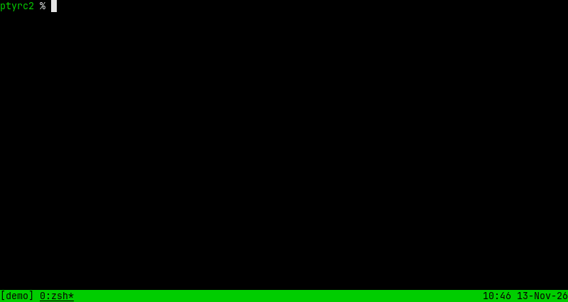
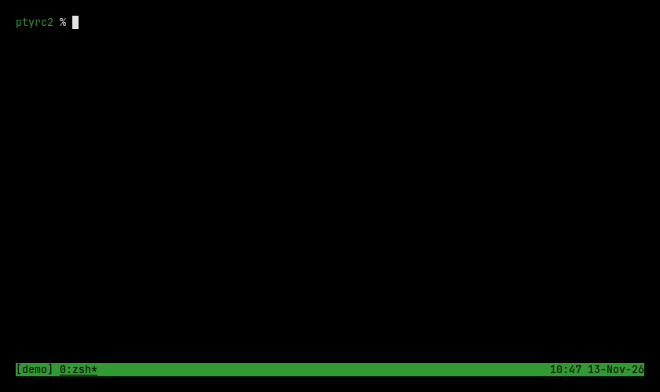
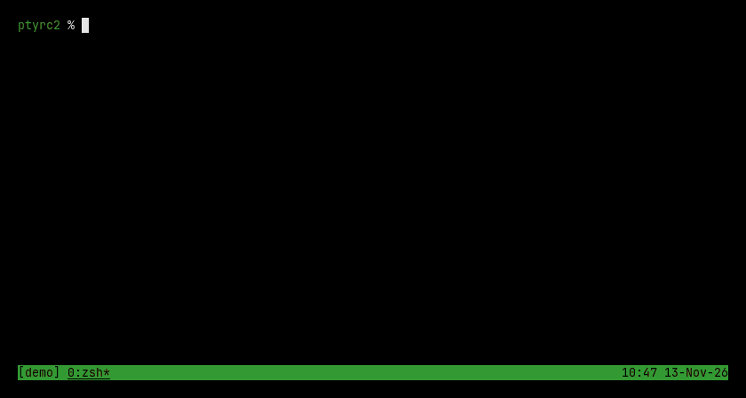

> This has been produced with assistance of generative coding agents.
>
> This file was written by a human. Use at your own risk.

# `ptyrc2` – the pty remote controller

This started as [`ptyrc`](https://github.com/pcplpc/ptyrc) a work done by hand
with the love of a human, but now with slop and unreviewed code.

The initial goal was to wrap a CLI application like [`vim`](https://vim.org) to
add confetti to its output.



# Quick setup

This is not yet published on [PyPI](https://pypi.org):

```sh
# install instructions assuming https://github.com/pcplpc/ptyrc2 as url
```

Wrap any application with `ptyrc` as follows:

```sh
ptyrc run vim ~/.vimrc
```

You can use `ptyrc python` to start an interactive session:

```py
Connected to "vim /home/plcp/.vimrc"
>>> pilot.argv
['vim', '/home/plcp/.vimrc']
>>> pilot.size
(110, 13)
>>> pilot.cursor()
Cursor(x=0, y=0, visible=True, frame=2, trail=(), pos=(0, 0))
>>> pilot.find("syntax on")
[Match(frame=0, x=0, y=10, len=9, text='syntax on', screen=(0, 10))]
>>> pilot.send("jjj$")
>>> pilot.cursor().x
35
>>> pilot.send("ohello world!")
>>> pilot.keys("esc")
>>> pilot.text()[4]
'" hello world!'
>>> pilot.draw(["<3"], near="nocompatible", fg="red")
Sprite(1)
>>> pilot.keys(":q!", "enter")
>>> pilot.connected
False
```

Running `ptyrc python script.py` runs the script with `pilot` defined.

You can also start a user-provided app that draws on screen:

```sh
ptyrc app bricks
```

If no pilot is attached `ctrl+t ctrl+t` twice starts an app at random.

## Gallery

### fishes


### rain


### snow


### sand


### misc

Showcase of manual piloting with an interactive shell:



Use `ctrl+t ctrl+t` to start apps in idle drivers:



## Development

You can use:

```sh
cargo test --workspace
uv sync && uv run pytest
```

Honestly, the codebase is still full of slop:

- this human have NOT pour in the time (yet) to make it good to look at :(

You can still point your agent at it to write custom apps.

## License

This project uses `GPL-3.0-or-later` where applicable.

See `LICENSE.txt`.
